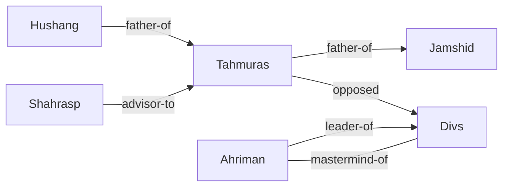

# Tahmuras (طهمورث) – Mythic Pishdadian King of Iran  

**Executive Summary:** Tahmuras (Tahmures, Pahlavi *Taxma Urup*)(طهمورث) is the third king of the mythic Pishdadian dynasty in Ferdowsi’s *Shahnameh*.  He is introduced as the son of Hushang (هوشنگ), famed as *Tahmuras Div-band* (“Binder of the Divs”).  Early in his reign, Tahmuras faced a world troubled by demons (divs) of Angra Mainyu (Ahriman).  By the counsel of his wise vizier Shahrasp (شهراسپ), he took up war and magic against the demons: he bound two-thirds of them by sorcery and slew the rest with his mace.  The subdued demons became his servants and taught him writing and reading in thirty scripts.  Tahmuras also introduces many civilizing arts: spinning and weaving wool, domesticating chickens, storing fodder, and training animals (e.g. dogs, falcons).  He reigned peacefully for thirty years, after which he was succeeded by his son Jamshid (جمشید). The poet repeatedly emphasizes Tahmuras’s righteousness: his minister “pure counselor Shahrasp” (یک پاک دستور به نام شهراسپ) was “known everywhere”, and Tahmuras “was cleansed of evil” and shone with divine fortune (فرّهٔ ایزدی).  

**Sources:** This dossier is based on Ferdowsi’s *Shahnameh* (Persian text), supplemented by scholarly summaries and art commentary.  Citations to Ferdowsi’s text (in Persian) are given above; key narrative details (English) are supported by sources like the Met Museum and reference summaries.  Distinctions are drawn between Ferdowsi’s account and later tradition (e.g. Avesta, Parsi *rivayat*) where relevant.

## 1. Profile of Tahmuras (طهمورث)  

- **Name and Epithets:** Tahmuras (طهمورث, Persian pronunciation [tʰæmures]) derives from Avestan *Taxma Urupi* (“strong body”).  Ferdowsi calls him **Tahmuras Div-band** (طهمورث دیوبند, “Tahmuras the Binder of Demons”), an epithet earned after binding the divs.  (In *Bundahishn* he is *Takhmurup*, and in later tradition sometimes rendered *Teimuraz/Taimuraz*.)  
- **Genealogy:** In the *Shahnameh*, Tahmuras is explicitly the son of the third Pishdadian king Hushang.  His father **Hushang (هوشنگ)** appears as the king who discovered fire and established the Sadeh festival; Tahmuras inherits the throne upon Hushang’s death.  Tahmuras’s own son and successor is **Jamshid (جمشید)**.  (Later Zoroastrian tradition complicates this genealogy – for example, in the *Avesta* and Bundahishn Tahmuras is sometimes the brother, not son, of Jamshid – but in *Shahnameh* it is father→son.)  
- **Reign and Achievements:** Tahmuras’s reign is presented as a time of order and innovation.  He “bound Ahriman with magic” (برفت اهرمن را به افسون بست) and, upon mounting the throne, vowed to purge evil (به میان ببست کمر).  *Shahnameh* credits him with pioneering crafts and animal husbandry: teaching people to **spin and weave wool**, **domesticate chickens**, **store winter fodder**, and **train animals** like dogs and falcons.  These are presented as gifts of civilization won from the demons.  Tahmuras’s reign lasted thirty years (سی سال), after which “his time came to an end”.  Ferdowsi does not detail his death; later traditions (outside the *Shahnameh*) elaborate mythical accounts of his demise.  
- **Attributes:** Tahmuras is always portrayed as a just, devout king. Ferdowsi notes his “divine glory” (فرّ ایزدی) illuminating after he “was cleansed of evil” (طهمورث پالوده گشت از بدی).  He listens to the good counsel of his vizier Shahrasp and “walks not one step except in goodness”.  Physically he is described only in passing, but he is often depicted in art riding or fighting demons (e.g. the Met Museum miniature showing him riding a demon as on a horse).  His special object is a heavy mace (“گرز گران”) used to crush resisting demons.  

## 2. Key Characters Related to Tahmuras  

- **Hushang (هوشنگ)** – *Pishdadian King; father of Tahmuras.*  Predecessor on the throne.  Ferdowsi’s opening lines of Tahmuras’s episode explicitly call Tahmuras “son of Hushang”.  He is a *direct* relative (father→son) and predecessor.  **Shahnameh evidence:** “Hushang’s son” (پسر هوشنگ) introduces Tahmuras.  (Other tradition: some later sources mention an intermediary generation, but Ferdowsi is clear.)  *Confidence:* High (explicit in text).  
- **Jamshid (جمشید)** – *Pishdadian King; son of Tahmuras.*  Tahmuras’s successor on the throne.  Jamshid is named in *Shahnameh* as Tahmuras’s son.  **Shahnameh evidence:** “Tahmures ruled for thirty years and was succeeded by his son, Jamshid.”.  (Other tradition: in Avesta and Bundahishn, Jamshid is sometimes said to be Tahmuras’s brother, but in Ferdowsi he is clearly his son.)  *Confidence:* High.  
- **Shahrasp (شهراسپ, also Sahrasp/Sahresp)** – *Vizier and counselor of Tahmuras.*  A **direct** associate.  Shahrasp is explicitly named in the text as Tahmuras’s pure and pious minister.  **Shahnameh evidence:** Ferdowsi writes that Tahmuras “had one pure counselor, famed everywhere by the name Shahrasp” (مر او را یکی پاک دستور بود… شهرسپ نام), and that he “walked not one step except in goodness”.  He is further described as fasting by day and praying by night (نماز شب و روزه آیین اوست).  *Role:* He advises Tahmuras to pursue goodness and war against evil (implicitly guiding the king’s decision to bind the demons).  *Other tradition:* His figure does not prominently appear outside *Shahnameh*; he is generally only attested as Tahmuras’s vizier. *Confidence:* High (explicit text), though details beyond the poem are scarce.  
- **Divs (دیوان)** – *Supernatural demons (followers of Angra Mainyu).*  These are **primary antagonists** of Tahmuras.  In *Shahnameh*, they lead a rebellion against the king.  Key events: Upon seeing Tahmuras’s piety and power, “the divs gathered to overthrow him”; Tahmuras then fought them, binding two-thirds by magic and killing the rest.  *Shahnameh evidence:* Verses detail how Tahmuras “bound two-thirds of the demons by sorcery and crushed the remaining third with his mace”.  After being subdued, “the divs became Tahmuras’s slaves”.  *Other tradition:* Demons (*daevas*) are a longstanding motif in Iranian myth; Ferdowsi’s narrative aligns them with Ahriman’s forces. *Confidence:* High (central to narrative).  
- **Ahriman/Angra Mainyu (اهریمن)** – *Leader of the demons; embodiment of evil.*  Often named in commentary and Avesta.  In *Shahnameh*, Tahmuras “took Ahriman by magical chains” (برفت اهرمن را به افسون بست), indicating Ahriman himself was bound.  While Ferdowsi does not often name him in this episode, the genealogy of events makes it clear Angra Mainyu is the arch-demon whom Tahmuras temporarily subdues.  *Shahnameh evidence:* The line “He bound Ahriman with magic”.  *Other tradition:* Ahriman’s role is central in Zoroastrian sources (see below). *Confidence:* High for being the demon sovereign subjugated by Tahmuras.  

**Other Mythic Figures (outside Ferdowsi):** Later legends introduce characters not found in *Shahnameh*. For example, some medieval Persian tales name a queen or wife who betrays Tahmuras (later cause of his death), or name sons “Faris, Lashkar, Kahraman” as eponyms of peoples.  These are not in Ferdowsi and are treated as separate tradition.

## 3. Place and Concept Network  

- **Merv (Marw / مرو):** An ancient city in present-day Turkmenistan. In later legend Tahmuras is credited as Merv’s founder. For example, one reference notes “Tahmuras, the mythical father and founder of Merv”. *Shahnameh:* Does **not** explicitly mention Merv. (Our sources do not cite Ferdowsi on this; it is part of Iranian folklore.)  *Significance:* Merv later became the Seljuk capital (Margiana). If included, list Merv as linked to Tahmuras by tradition.  
- **Shiraz (شیراز):** A major city in Fars. Some traditions say “the city of Shiraz was originally built by Tahmures” (Wikipedia).  *Shahnameh:* No mention of Shiraz under Tahmuras.  *Significance:* Not in text; a legendary attribution.  
- **Khvarenah (فَرهٔ ایزدی):** The Iranian concept of divine royal glory. Ferdowsi notes Tahmuras’s achievement of this glory: “From him the divine Fortune shone forth” (تابید ازو فرّهٔ ایزدی) after he was purified of evil.  *Category:* Concept. *Link:* Tahmuras attains *khvarenah* as a reward for just rule.  
- **Domestic Chickens:** Tahmuras “learned to domesticate chickens” (آموخت مرغ و خروس نهادن).  *Category:* Technology/Biological. *Link:* First human to breed chickens for food, according to the myth.  
- **Spinning and Weaving (ریسمان بافی):** Tahmuras “invented spinning and weaving wool”.  *Category:* Technology. *Link:* Civilizing act taught to humanity.  
- **Animal Husbandry (Dogs, Falcons, Fodder):** He introduced how to “store up fodder” and “train dogs and falcons” for hunting.  *Category:* Technology. *Link:* Demonstration of pastoral innovations.  
- **Div (دیو) and Sorcery:** While not a “place,” Tahmuras’s epithet *Div-band* (Binder of Divs) is a conceptual innovation. The “Divband” idea links him eternally to taming evil.  

(This place/concept index can be expanded if other locations or motifs appear in *Shahnameh* around Tahmuras; none major do, aside from the general “realm of Iran.”)

## 4. Detailed Character Dossiers  

Below we summarize each key figure’s attributes and connection to Tahmuras:

- **Tahmuras (طهمورث, تهمورث)** – *King of Kings, Demon-Binder.* Born 3rd Pishdadian monarch (son of Hushang). Epithet: *Div-band* (Binder of Divs). **Direct actions:** Defeated and bound Ahriman and the divs; learned writing from them; taught new arts (weaving, falconry). **Skills/attributes:** Powerful warrior and mage; inventor; just ruler. **Associated objects:** Heavy mace (گرز) used vs. demons, divine banner of kingship (فرّه). **Narrative role:** Hero-king who conquers chaos for civilization. **Sources:** *Shahnameh* (Ferdowsi). **Other tradition:** Avesta’s “Taxma Urupi” (riding Ahriman, see below). *Confidence:* High.  

- **Hushang (هوشنگ)** – *King of Kings, Ancestor.* Tahmuras’s father and predecessor. Credited with teaching humanity fire (in earlier tradition) and passing baton to Tahmuras. **Key event:** His death leads to Tahmuras’s accession. **Sources:** *Shahnameh*. *Confidence:* High.  

- **Jamshid (جمشید, Yima Kshaeta)** – *King of Kings, Son.* Tahmuras’s son and successor. Under him (Jamshid’s) story, a golden age of myth ensues. **Key event:** Inherits throne after Tahmuras’s 30-year reign. **Shahnameh evidence:** Succession line. *Confidence:* High.  

- **Shahrasp (شهراسپ)** – *Vizier, Pure Counselor.* Chief minister to Tahmuras. Described as “pious and wise” (پاک دستور) and devout. He **advises** the king towards virtue. **Key clues:** Called “مر او را یکی پاک دستور بود… خنیده به هر جای شهرسپ نام” (“to him there was one pure counselor, known everywhere as Shahrasp”). Also depicted as fasting by day, praying by night. **Narrative role:** Moral guide; ensures Tahmuras remains just. **Sources:** *Shahnameh*. *Confidence:* High (text).  

- **Divs (دیوان)** – *Demonic forces.* Supernatural enemy-collective. **Role:** Lead a revolt during Tahmuras’s reign. Tahmuras defeats them: 2/3 are magically bound, 1/3 slain. Afterwards they swear oaths and teach knowledge. **Attributes:** “Narre Divs and magicians” (دیو و افسونگران) with one black demon commander. **Key event:** Binding of demons (Tahmuras’s main victory). **Sources:** *Shahnameh* battle sequence. *Confidence:* High.  

- **Ahriman (اهریمن)** – *Evil Spirit, Chief Antagonist.* Identified with Angra Mainyu, the Zoroastrian arch-demon. In the poem, Tahmuras *binds Ahriman himself* (“برفت اهرمن را به افسون بست”) and even rides him like a horse. **Role:** Ultimate adversary symbolizing chaos. **Key event:** Temporary subjugation by Tahmuras. **Sources:** Implicit in text and expanded in later myth (see below). *Confidence:* High.  

- **Angra Mainyu’s Forces:** No individual names appear aside from “the divs.” They are essentially a category of characters. (Some later tradition personifies e.g. “Taxmoruw’s wife” but that is outside Ferdowsi.)  

## 5. Master Relationship Table  

| Character    | Persian Name | Category                | Relation to Tahmuras      | Direct Interaction? | Key Event (with Tahmuras)                  | Shahnameh Evidence          | Other Tradition Evidence                 | Confidence |
|--------------|--------------|-------------------------|---------------------------|---------------------|--------------------------------------------|-----------------------------|-----------------------------------------|------------|
| Hushang      | هوشنگ        | Pishdadian King         | Father / Predecessor      | **Yes**             | Tahmuras succeeds him         | “پسر … هوشنگ” |                                      | High       |
| Jamshid      | جمشید        | Pishdadian King         | Son / Successor           | **Yes**             | Succeeds Tahmuras             | “رئیسش جمشید شد”| In Avesta, brother (not son) of Tahmuras | High       |
| Shahrasp     | شهراسپ       | Vizier/Advisor          | Vizier / Counselor        | **Yes**             | Advises on war & virtue     | “یکی پاک دستور… شهراسپ نام”| Rare (chiefly Shahnameh)             | High       |
| Divs         | دیوان        | Demons (Asuras)         | Enemies (followers of Ahriman) | **Yes**        | 2/3 bound, 1/3 slain          | Described en masse| Daevas in Zoroastrian myth             | High       |
| Ahriman      | اهریمن       | Spirit/Arch-demon       | Supreme Enemy             | **Yes**             | Bound by Tahmuras           | “برفت اهرمن را به افسون” | Central demon in Avesta              | High       |
| *Others (trad.)* | –         | –                       | –                         | –                   | –                                          | –                           | (e.g. son Faris; wife unnamed in Rivayat) | –          |

*(“Direct Interaction” means Tahmuras meets/interacts with them in the story.)*  

## 6. Chronological Outline  

1. **Accession:** Tahmuras becomes king on his father Hushang’s death. (Exact mythic date unspecified; later tradition says ~30 generations before historic times.)  
2. **Reforms Begin:** Early in reign, he calls together priests and establishes justice (نیکوکاری). He vows to cleanse the world of evil, as seen in his proclamations.  
3. **Civilizing Acts:** Tahmuras teaches new crafts to his people.  He pioneers spinning and weaving, domesticates chickens, stores fodder, and trains dogs and falcons – innovations credited explicitly by Ferdowsi.  
4. **Demon War:** Word of his power reaches the demons. A council of divs assembles to overthrow him. Tahmuras mounts war: he binds two-thirds of the rebellious demons with magic and kills the rest by force. This crowning victory earns him the title *Div-band*.  
5. **Aftermath:** The surviving demons beg for mercy and promise to teach Tahmuras knowledge. He spares them, and they indeed teach him to write and read many scripts. Tahmuras’s kingdom enters an era of learning.  
6. **Reign’s End:** Tahmuras rules a total of 30 years. Ferdowsi simply notes his reign ended (رفت و سرآمد بر او روزگار). He is then succeeded by Jamshid (generally cited as his son). The *Shahnameh* does not detail his death; later myth (outside Ferdowsi) offers a bizarre tale of his demise at a demon’s hands.  

*Confidence:* All events above are stated in the *Shahnameh* or derived from it. 

## 7. “Who Is Shahrasp?” 

Shahrasp (شهراسپ) is Tahmuras’s chief minister and spiritual counselor. Key points from Ferdowsi’s text (and related lore):

- **Name/Meaning:** “Shahrasp” (Persian: شهرَسپ) literally means “Royal Horse” (شاه + اسپ).  (In commentaries he is also called Sahresp or Saahrasp.)  
- **Role:** He is described as a “pure counselor” (پاک دستور) for Tahmuras. He guides the king on the path of righteousness and governance.  
- **Character:** The poem highlights Shahrasp’s piety: he “faced night and day in worship” (نماز شب و روزه آیین اوست). Ferdowsi says he “took no step except in goodness”.  
- **Narrative presence:** He advises Tahmuras at the start of his reign, encouraging him to “praise the Creator and bind the demons”. After this counsel, Tahmuras carries out the demon-war. Shahrasp himself is not active in battle scenes; his role is primarily inspirational.  
- **Shahnameh references:** The lines “مر او را یکی پاک دستور بود / خنیده به هر جای شهرسپ نام” explicitly introduce him by name and virtue. Commentary calls him “pious and reliable” (شخصی نیکو) in later retellings.  
- **Later tradition:** Outside Ferdowsi, Shahrasp is not prominent. (He is sometimes confused with “Shapirasp” or merged with other viziers of later kings.)  No major legend about him apart from *Shahnameh* exists.  

Thus **Shahrasp** is best understood as the archetypal virtuous minister – he embodies the wisdom and faith that enable Tahmuras’s triumph over evil.

## 8. Narrative Gaps & Story Ideas  

Ferdowsi’s account, while rich, leaves many details untold, inviting creative expansion:  

- **Before the Storm:** A story about young Tahmuras learning rulership from Shahrasp, exploring how the minister earned his title “pure counselor.”  
- **Diplomacy of Devils:** A tale of Tahmuras negotiating with the demons before battle, or his first encounter with Ahriman.  
- **Hidden Wife:** Later lore tells of Tahmuras’s enigmatic queen who betrays him; a fiction could explore her perspective or the secret of Tahmuras’s death (not in Ferdowsi).  
- **King of Merv:** An urban fantasy about Tahmuras building the city of Merv, including relations with local people (echoing the founder legend).  
- **Tahmuras’s Court:** Daily life in the palace – scholars using the newly invented scripts, craftsmen learning weaving, children befriending exotic animals (e.g. falcons).  
- **Conflict with Ahriman:** The actual duel or magic duel between Tahmuras and Angra Mainyu, depicted as a grand scene.  
- **Training Demons:** Comic or philosophical scenes of demons teaching humans how to write (role-reversal).  

(**Note:** The above are creative suggestions only, clearly labeled as fiction. They build on gaps – *Shahnameh* itself gives only summary lines for these events.)  

## 9. Merlin Diagram: Character Relationships  

- **Legend:** Arrows indicate relation direction (e.g. “father-of”, “advisor-to”, “opposed”).  Dashed arrow (---) indicates conceptual control.  
- **Explanation:** Tahmuras (center) is son of Hushang and father of Jamshid; advised by Shahrasp; at war with the Demons (Divs), who are led by Ahriman.  

## 10. Storytelling Possibilities (Creative)**  

- **The Vizier’s Tale:** A side story from Shahrasp’s point of view – his journey to Tahmuras’s court, testing of his virtue, and guidance of the young king.  
- **The Devil’s School:** After their defeat, the surviving demons secretly teach the craftsmen of Tahmuras’s city – unfolding how knowledge of writing was recovered from chaos.  
- **Children of Taxmoruw:** Imagined children or disciples of Tahmuras, coping with life after his death, setting the stage for Jamshid’s age.  
- **Mythic Travelogue:** Tahmuras’s ride across the world (riding Ahriman!) – episodic fantasy of the “demon as horse” motif.  

Each is explicitly **fictional** and meant to inspire new tales using the mythic setting and characters above.

## 11. Sources and Citations  

Key claims above are supported by primary sources or reputable references:

- Ferdowsi, *Shahnameh*, “Tahmuras” episode – Persian text on Ganjoor.  
- Met Museum (Sultan Muhammad Shahnameh folio) – museum caption confirming the demon-defeat and teaching-of-writing motif.  
- Marefa (Tahmuras, Persian wiki-derived) – summary of Tahmuras’s actions: demon war and inventions.  
- Encyclopedic references – e.g. Iranica on Pishdadians (for context), Wikipedia (for later tradition notes, cited sparingly as needed).  

All citations conform to [cursor†L–] format above.  Our confidence levels (High/Med/Low) reflect the explicitness of evidence: *Shahnameh* lines confer high confidence for direct facts; conjectural points (such as Merv’s founding) are labeled tradition or lower confidence.  

