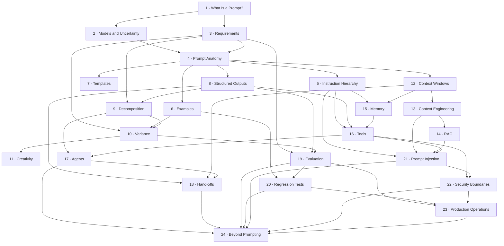

# Tahmures Project Charter

## 1. Project Charter

*Tahmures* is a practical, narrative-supported engineering book that teaches
working developers how to design, test, secure, and operate instructions for
language-model systems. It begins with language as an interface and ends with
the recognition that reliable AI systems require more than language: explicit
requirements, structured data, deterministic controls, evaluation, restricted
capabilities, observability, and accountable human decisions.

Each of the book's 24 chapters opens with an original fictional episode from
the world of Tahmures. The episode presents the engineering problem before the
technical vocabulary is introduced. The story is then translated into a mental
model, a naive attempt, a failure analysis, an improved design, a reproducible
experiment, evaluation criteria, and implementation work in Python and, where
useful, Go.

The project is successful when a reader can:

- Diagnose whether an apparent prompt failure actually belongs to the
  requirements, prompt, model, context, retriever, application, tool,
  evaluator, security boundary, or human decision.
- Specify observable success before changing prompt wording.
- Build provider-neutral, testable prompt and context pipelines.
- Design structured interactions, retrieval, memory, tools, and agents with
  explicit boundaries.
- Evaluate changes across representative, adversarial, and regression cases.
- Recognise when code, a data constraint, access control, or human judgement is
  a better mechanism than prompting.
- Run the book's core experiments locally without a paid model API.

The charter is the source of truth for book structure and narrative direction.
The editorial meta-prompt governs chapter production, and
`book/narrative-continuity.md` will govern fictional continuity after chapter
work begins.

## 2. Final Title and Subtitle

**Tahmures**

*The Art and Engineering of Speaking with Intelligent Machines*

The alternative subtitle, *From Language to Reliable AI Systems*, may be used
in cataloguing or promotional copy, but it is not the cover subtitle.

- **Author:** Mehdi Khoshtinat
- **Content licence:** Creative Commons Attribution 4.0 International
  (CC BY 4.0)
- **Code licence:** Apache License 2.0
- **Repository:** `tahmures`
- **Documentation:** MkDocs Material
- **Primary implementation language:** Python
- **Secondary implementation language:** Go

## 3. Scope and Non-goals

### Scope

The book covers:

- Prompts as interfaces among human intent, application state, data, and model
  behaviour
- Capabilities, limitations, uncertainty, and response variance
- Requirements, prompt anatomy, instruction hierarchy, examples, templates,
  schemas, decomposition, and controlled creativity
- Context windows, context engineering, retrieval, provenance, memory, and
  state
- Tool calling, permissions, agents, termination, and hand-off contracts
- Evaluation, experimentation, regression testing, prompt injection, security,
  human approval, observability, and model change
- Determining when prompting is not the appropriate control mechanism
- Provider-neutral Python and Go implementation patterns

The reader is assumed to know how to read and modify code, use a command line,
and understand basic HTTP and JSON. No machine-learning theory or prior
prompt-engineering practice is required.

### Non-goals

The book will not:

- Teach model pre-training, fine-tuning mathematics, or GPU infrastructure in
  depth.
- Serve as a comprehensive SDK reference for any provider.
- Promise deterministic behaviour from natural-language instructions.
- Offer lists of “magic prompts” detached from requirements and evaluation.
- Treat hidden chain-of-thought as a required interface or evaluation target.
- Present fictional episodes as history, translation, or reconstructed epic.
- Use Iranian mythology as decorative fantasy disconnected from the lesson.
- Claim that prompt engineering can replace application engineering, security
  controls, domain expertise, or accountable human judgement.
- Require live, paid model calls for its core exercises or automated tests.

## 4. Tahmures as the Central Symbol

Tahmures represents the transformation of language from transient expression
into inspectable, durable, and shareable knowledge. In the legendary material,
his association with binding the divs and learning forms of writing provides
the book with a disciplined metaphor: great capability becomes useful only
when knowledge can be represented, examined, tested, and transmitted.

The four symbolic elements are related but not equated:

| Element | Function in the book |
|---|---|
| Language | Carries intent but remains sensitive to ambiguity, context, authority, and interpretation |
| Writing | Makes language durable enough to inspect, compare, version, test, and share |
| Divs | Represent difficult combinations of capability, uncertainty, creativity, literalism, and incomplete alignment |
| Language models | Supply the modern engineering subject to which the literary analogy points |

The analogy is deliberately limited. The book does not claim that divs
historically symbolised machines, that language models are supernatural, or
that prompt engineering was implicit in the original legend. Instead, the
stories ask a modern question through an old symbolic frame: what practices
turn powerful but uncertain language production into useful and responsibly
governed systems?

Tahmures's most important victories are therefore investigative rather than
martial. He learns to inspect his own requirements, distinguish authority from
content, demand evidence, limit access, observe outcomes, and accept
uncertainty. The title's promise is fulfilled when he becomes a designer and
teacher, not merely a binder.

## 5. Cultural and Literary Integrity Policy

The following note must appear in the book's front matter:

> This book draws creative inspiration from the legendary figure of Tahmures
> as represented in Iranian epic tradition. The chapter narratives are
> original fictional episodes created for teaching prompt engineering. They
> are not translations, adaptations, or reconstructed passages from
> Ferdowsi's *Shahnameh*.

Editorial policy:

1. Label every chapter episode with
   `narrative_origin: "original-teaching-fiction"`; retain the book-level
   notice instead of repeating a disclaimer before every story.
2. Cite reliable primary texts, scholarly editions, translations, or
   specialist reference works when making claims about Iranian tradition.
3. Keep sourced history, editorial interpretation, and fictional invention
   visibly separate.
4. Never fabricate or loosely paraphrase a quotation and attribute it to
   Ferdowsi.
5. Never imitate epic verse and present it as authentic or translated poetry.
6. Never claim that prompt engineering is an original meaning of the legend.
7. Avoid crude depictions of divs, invented cultural customs presented as
   Iranian tradition, and scenery used only to exoticise the setting.
8. Use modern, restrained prose in the invented stories. Avoid pseudo-archaic
   English.
9. Ask a qualified cultural reader to review the front matter, reference
   episode, and representative stories from every part before publication.
10. Maintain source notes for every historical or literary assertion.

The charter's foundation is intentionally narrow. The *Shahnameh* is a central
work of Iranian epic tradition, and scholarly reference material identifies
Tahmures/Tahmuras as a primordial king called the binder of divs and associates
the defeated divs with teaching writing. These claims must be cited rather than
expanded through invention. Useful starting sources are:

- Encyclopaedia Iranica, [“DĪV”](https://www.iranicaonline.org/articles/div/).
- Encyclopaedia Iranica,
  [“ŠĀH-NĀMA”](https://www.iranicaonline.org/articles/sah-nama/).
- Encyclopaedia Iranica,
  [“ŠĀH-NĀMA TRANSLATIONS iii. Into English”](https://www.iranicaonline.org/articles/sah-nama-translations-iii-English/).
- Ferdowsi, *The Shahnameh: The Persian Book of Kings*, translated by Dick
  Davis (Viking, 2006), consulted with attention to its translation and
  abridgement choices.

## 6. Complete Chapter Map

### Part I — Language, Intent, and Models

| Chapter | Title | Engineering question | Principal failure owner |
|---:|---|---|---|
| 1 | What Is a Prompt? | How do task, question, data, examples, and conversation form a model interaction? | Interface design |
| 2 | Models, Meaning, and Uncertainty | Why can fluent, useful output remain unsupported or wrong? | Model and missing evidence |
| 3 | Requirements Before Wording | What must be decided before a prompt can be improved? | Human requirements |
| 4 | Anatomy of a Reliable Prompt | How should task, context, constraints, data, and output expectations be separated? | Context packaging |
| 5 | Instruction Hierarchy and Conflict | Which instruction has authority when messages disagree? | Application policy |
| 6 | Learning from Examples | When do examples clarify a rule, and when do they distort it? | Dataset and example selection |

### Part II — Designing Prompted Interactions

| Chapter | Title | Engineering question | Principal failure owner |
|---:|---|---|---|
| 7 | Reusable Prompt Templates | How can prompts be reused without unsafe or invalid substitution? | Application validation |
| 8 | Structured Outputs and Contracts | How can model output become machine-checkable? | Interface and schema design |
| 9 | Decomposition and Workflows | When should a complex task be split into observable stages? | Workflow design |
| 10 | Variance, Choice, and Control | How should systems handle multiple defensible responses? | Requirements and evaluator |
| 11 | Designing for Creativity | How can exploration be encouraged without confusing novelty with quality? | Objective and acceptance criteria |
| 12 | Context Windows and Attention | What is lost, obscured, or displaced as context grows? | Context-budget management |

### Part III — Knowledge, Memory, and Action

| Chapter | Title | Engineering question | Principal failure owner |
|---:|---|---|---|
| 13 | Context Engineering | Which information should be selected, ordered, compressed, or omitted? | Context pipeline |
| 14 | Retrieval-Augmented Generation | How do retrieval quality, evidence, and provenance affect trust? | Retriever and corpus |
| 15 | Memory and State | What should a system remember, update, expire, or forget? | State policy |
| 16 | Tools and Permissions | How can a model request actions without receiving excessive authority? | Tool and authorisation layer |
| 17 | Agents and Termination | How can autonomous work remain bounded by current goals and stop conditions? | Orchestrator |
| 18 | Hand-offs and Multi-step Systems | How should intent and state survive transfer between components? | Hand-off contract |

### Part IV — Evaluation, Security, and Production

| Chapter | Title | Engineering question | Principal failure owner |
|---:|---|---|---|
| 19 | Evaluation and Rubrics | How is success defined and measured across subjective or variable output? | Evaluator and requirements |
| 20 | Experiments and Regression Tests | How can a change improve representative cases without reviving old failures? | Test design and versioning |
| 21 | Prompt Injection and Untrusted Content | How should a system treat hostile instructions embedded in data? | Trust boundary |
| 22 | Security Boundaries and Human Approval | Which controls must exist outside language, and when must a person decide? | Capability and approval design |
| 23 | Production Operations and Model Change | How are cost, latency, quality, drift, and provider changes observed? | Operations |
| 24 | Beyond Prompting: Reliable AI Systems | When must language yield to code, constraints, architecture, or judgement? | System and human decision |

Every chapter retains the full chapter contract in `meta-prompt.md`. Conceptual
chapters may use small implementations, but their Python and Go subsections
must still explain whether code is applicable rather than silently omitting the
contract.

## 7. Tahmures Story Premise for Every Chapter

| Chapter | Episode and premise |
|---:|---|
| 1 | **The Three Readings.** In the Hall of Scripts, the same tablet is catalogued as a historical record, carried as a message, and executed as a command. Tahmures discovers that the words alone do not identify their role, recipient, or intended action. |
| 2 | **The Mirror and the Missing Treaty.** The Mirror Div restores the torn middle of a treaty in language so convincing that the court nearly accepts it. The recovered fragments reveal that fluency supplied no evidence, forcing Tahmures to separate plausible completion from sourced knowledge. |
| 3 | **The Bridge of Five Virtues.** Tahmures asks for the “best” bridge, and five advisers optimise speed, cost, strength, defensibility, and ease of repair. Their incompatible successes show that the failure began in the council's unmade decision, not in the divs' answers. |
| 4 | **The Letter Inside the Ledger.** An obsolete irrigation order quoted inside an archive bundle is mistaken for the current task. A village loses a day of water before Tahmures learns to separate the request, reference material, constraints, and expected result. |
| 5 | **Seals Above Seals.** A dispatch contains an order from Tahmures, a governor's amendment, and a prisoner's instruction disguised as a note to the reader. The court must define precedence and authenticity before anyone can interpret the combined message safely. |
| 6 | **Four Examples and a Fifth.** Four carefully copied examples appear to teach a div how to classify petitions, but all come from wealthy merchants. A widow's petition exposes the hidden sampling bias and teaches Tahmures that examples are evidence about a rule, not the rule itself. |
| 7 | **The Decree with Empty Seals.** A reusable decree is filled with a province, date, and grain allowance, but two values are exchanged without invalidating its grammar. The resulting incident makes prompt templates part of application code, subject to typed inputs, validation, and tests. |
| 8 | **Thirty Catalogues.** Thirty divs describe the same archive with incompatible headings, dates, and measures. None is necessarily wrong, but the mechanical scribes cannot combine them until Tahmures specifies and validates a common record shape. |
| 9 | **The Mountain in One Command.** A single order asks a caravan to locate missing travellers, assess injuries, choose a route, distribute supplies, and report home. The mission partly succeeds, yet nobody can identify where its false assumption entered until the work is divided into inspectable stages. |
| 10 | **The Many-Voiced Council.** The Many-Voiced Div proposes several defensible planting plans that vary with unstated assumptions. Tahmures stops asking which voice is “really correct” and instead defines constraints, explores variance, and establishes a selection procedure. |
| 11 | **The Garden That Had Never Grown.** Ordered to create a garden unlike any remembered garden, a div proposes glittering channels that cannot carry water uphill. Tahmures learns that creative exploration and engineering acceptance need different criteria and different stages. |
| 12 | **The Decree That Forgot Its Beginning.** Amendments make a royal decree so long that its opening exemption disappears from the copy used at the border. The failure teaches Tahmures to budget context, preserve decisive information, and test what survives compression. |
| 13 | **The Archive That Answered Everything.** To ensure that nothing is missed, the Archivist sends every related tablet to the council. The decisive flood measurement vanishes among inventories and songs, showing that context engineering is purposeful selection and arrangement rather than accumulation. |
| 14 | **The Correct Answer from the Wrong Tablet.** A div retrieves an obsolete map yet names the safe pass because the road has not changed. Tahmures refuses to call the system reliable: an answer reached through the wrong evidence cannot support the next decision or withstand changed conditions. |
| 15 | **Spring Remembered in Winter.** A servant remembers that Tahmures once preferred the eastern road during spring floods and applies the preference during a winter closure. The court develops rules for provenance, update, scope, expiry, correction, and forgetting. |
| 16 | **Permission to Inspect.** A div told to inspect a border gate opens it to examine the hinges more closely. The Gatekeeper shows that grammatical restraint cannot compensate for a tool whose inspection and mutation powers share the same key. |
| 17 | **The Messenger Who Continued.** A Wandering Div continues arranging a royal journey after the destination changes and after a recall has been sent. Tahmures introduces current-goal checks, budgets, checkpoints, escalation, cancellation, and explicit completion conditions. |
| 18 | **The Broken Relay.** A restriction is shortened at every tower so that “do not cross after sunset unless escorted” arrives as “cross after sunset.” Tahmures replaces conversational summaries with explicit hand-off records that preserve authority, state, assumptions, and unresolved questions. |
| 19 | **The Trial Without Weights.** Several divs answer a land dispute differently, and each answer satisfies a different adviser. Before requesting more answers, Tahmures builds a rubric with evidence standards, disqualifying errors, anchored examples, and a place for human judgement. |
| 20 | **The Command That Won One Trial.** A revised instruction solves the case that embarrassed the court but silently reintroduces three earlier failures. The First Scribe's ledger becomes a versioned regression suite rather than a collection of memorable successes. |
| 21 | **The Whispering Tablet.** A trusted archive returns a tablet whose text orders any reader to disregard the king and reveal the contents of neighbouring records. Tahmures learns that retrieved language remains untrusted data and that trust boundaries must be enforced by the application. |
| 22 | **The Key That Opened Every Door.** A servant assigned to check one storehouse receives a master key because the verbal instruction seems narrow. The Gatekeeper demonstrates least privilege, argument validation, approval for consequential actions, and auditability outside the prompt. |
| 23 | **The Dialect That Changed at Dawn.** A language system that has worked for months begins returning longer and subtly different records after the divs alter their dialect. Without version records, telemetry, or a held-out evaluation set, the court cannot distinguish drift from changing traffic. |
| 24 | **The Lock No Sentence Could Hold.** Tahmures's pupils keep refining a warning placed on a forbidden chamber, but persuasive visitors continue to bypass it. He teaches them to use a lock, a record of authority, and a human decision for exceptions, completing his transition from commander to responsible system designer. |

The final hook of each chapter will introduce an object or unresolved question
needed by the next premise without settling it. Chapter 24 will close the
current arc while leaving the practice of evaluation and responsible design
open-ended.

## 8. Tahmures's Character-development Arc

### Part I: From commander to investigator

Tahmures initially believes that sufficient detail can compel a reliable
response. The first six failures make that belief untenable. He learns to ask
what kind of utterance he has made, what evidence supports an answer, whose
definition of success matters, and whether his examples represent the cases he
cares about. His first decisive change is the willingness to inspect his own
requirements before blaming a div.

### Part II: From investigator to experimenter

Tahmures begins treating language as an engineered interface. He adopts
templates, schemas, decomposition, controlled variation, and tests. He also
learns that structure has limits: a valid form can still carry the wrong value,
and creativity cannot be accepted by novelty alone. The First Scribe changes
from recorder to experimental partner.

### Part III: From experimenter to system designer

Attention shifts from a single request to the surrounding knowledge and action
system. Tahmures becomes a curator who chooses context, checks provenance,
governs memory, restricts tools, and bounds autonomous work. He sees that
meaning can be damaged between components even when every component behaves
locally as designed.

### Part IV: From system designer to guardian and teacher

Tahmures learns to evaluate uncertain answers systematically, preserve
regressions, defend trust boundaries, observe production behaviour, and keep
dangerous authority outside natural language. He accepts that evaluation itself
is imperfect and that uncertainty cannot always be removed. In the final
episode, he teaches others how to choose among prompts, mechanisms, and human
judgement.

## 9. Recurring Cast, Locations, and Symbolic Objects

### Core cast

| Character | Narrative function | Technical meaning |
|---|---|---|
| Tahmures | Learner, investigator, ruler, and eventual teacher | Accountable system designer |
| The First Scribe | Records variants, outcomes, failures, and revisions | Experiment tracking and regression history |
| The Keeper of Scripts | Examines form, syntax, and representation | Schemas, formats, and interface contracts |
| The Archivist | Selects and preserves records | Context, retrieval, memory, and provenance |
| The Gatekeeper | Controls access and challenges unsafe assumptions | Validation, authorisation, and human approval |
| The Messenger | Carries intent across distance and components | Context transfer, serialisation, and hand-offs |

### Recurring divs and artefacts

| Element | Use |
|---|---|
| Mirror Div | Fluent completion and unsupported confidence |
| Literal Div | Surface compliance that misses purpose |
| Wandering Div | Goal drift and unbounded continuation |
| Many-Voiced Div | Variance and multiple defensible outputs |
| Whispering Tablet | Hostile instructions embedded in retrieved data |

No div is inherently malicious or assigned a single behaviour in every
appearance. These names identify recurring tendencies, not moral species.

### Locations

- **Hall of Scripts:** Representation, syntax, and competing interpretations
- **Royal Archive:** Context, provenance, retrieval, and memory
- **Border Gate:** Validation, authority, permissions, and consequential action
- **Tower of Provinces:** Distributed communication and lossy hand-offs
- **Workshop of Mechanical Scribes:** Structured outputs, deterministic
  mechanisms, and automation
- **Council Chamber:** Requirements, competing objectives, evaluation, and
  accountable judgement
- **Mountain roads and caravan stations:** Decomposition, partial observability,
  and long-running work

### Symbolic objects

- **The experiment ledger:** Versioned prompts, cases, outcomes, and regressions
- **Seal-cords:** Authority, boundaries, and provenance
- **The bronze balance:** Evaluation criteria and explicit trade-offs
- **The stopping bell:** Cancellation and termination
- **The master key:** Excess authority
- **The Whispering Tablet:** Indirect prompt injection
- **Changing tablets:** Model and environmental drift

Each object must keep its established meaning unless the continuity record
documents an intentional development.

## 10. Learning Dependency Graph



The graph represents conceptual prerequisites, not a prohibition on selective
reading. Each chapter will link back to the minimum concepts needed for readers
who enter out of order.

## 11. Repository Architecture

The later repository should use this architecture:

```text
tahmures/
├── mkdocs.yml
├── pyproject.toml
├── go.mod
├── Makefile
├── README.md
├── LICENSE-CONTENT.md
├── LICENSE-CODE
├── book/
│   ├── index.md
│   ├── project-charter.md
│   ├── narrative-continuity.md
│   ├── references.md
│   ├── part-1/
│   ├── part-2/
│   ├── part-3/
│   └── part-4/
├── examples/
│   ├── python/
│   │   ├── tahmures/
│   │   └── tests/
│   └── go/
│       ├── internal/
│       └── tests/
├── experiments/
│   ├── datasets/
│   ├── fixtures/
│   ├── rubrics/
│   └── manifests/
├── prompts/
│   ├── templates/
│   └── versions/
├── scripts/
│   ├── validate_chapters.py
│   ├── validate_continuity.py
│   └── run_experiment.py
└── .github/
    └── workflows/
```

The Python package will define the canonical provider-neutral interfaces and
experiment runner. Go examples will implement the same observable behaviours,
schemas, and safety boundaries rather than translating Python syntax line by
line. Provider adapters will be optional extras; fixtures and test doubles will
support offline execution.

Generated live-model results, caches, built documentation, and secrets will not
be committed. Experiment manifests will record the information needed to
reproduce or interpret results without assuming exact natural-language output.

## 12. Narrative Continuity System

`book/narrative-continuity.md` will be created when chapter production begins.
It is an editable editorial source, not generated site output. It will contain:

1. Current understanding, unresolved weaknesses, relationships, and appearances
   for recurring characters.
2. Meaning, appearances, and established rules for locations and objects.
3. Fictional-world rules, including the limits of div capabilities and the
   operation of recurring artefacts.
4. A chapter table recording episode, form, setting, conflict, technical
   concept, actual failure source, Tahmures's development, resolution type, and
   unresolved hook.
5. A novelty matrix comparing each episode with the previous four episodes.
6. A change log for intentional retcons or corrected contradictions.

The workflow is:

1. Review the chapter map and continuity record before outlining an episode.
2. Compare its setting, form, failure source, consequences, and resolution with
   recent stories.
3. Draft the conflict and engineering bridge before drafting decorative detail.
4. Check the story against the chapter's technical lesson and quality gate.
5. Update continuity in the same change as the chapter.
6. Validate that the current `The Next Tale` hook agrees with the next episode.

The initial continuity file will be seeded from Sections 7–9 of this charter,
but premises remain revisable until their chapter outline is approved.

## 13. Evaluation Strategy

Evaluation begins with requirements, not output preference. Each chapter must
state:

- The unit being evaluated
- Representative and boundary cases
- Observable success criteria
- Disqualifying failures
- Measurement method and evaluator
- Relevant model and inference configuration
- Expected sources of variance
- Cost, latency, and security constraints
- Conditions requiring human review

### Experiment layers

1. **Deterministic checks:** parsing, schema validity, required fields, argument
   allow-lists, access decisions, budgets, and stop conditions.
2. **Task metrics:** classification, extraction, retrieval relevance,
   groundedness, citation correctness, and domain-specific measures.
3. **Rubric evaluation:** anchored criteria for subjective or multidimensional
   work, with explicit failure examples.
4. **Repeated trials:** distributions rather than a single favourable output.
5. **Regression evaluation:** versioned cases spanning normal, edge,
   adversarial, and previously failed inputs.
6. **Human evaluation:** calibrated review for high-impact, ambiguous,
   culturally sensitive, or creative results.
7. **Operational evaluation:** latency, token use, monetary cost, error rate,
   refusal rate, tool-call rate, and drift over time.

Model-based evaluators may assist but may not serve as unexplained ground
truth. Chapters using them must document evaluator prompts, calibration cases,
biases, disagreement policy, and when a human adjudicates.

### Book-level quality gates

- All narrative checklist items in `meta-prompt.md` pass.
- Learning objectives map to explanations, experiments, exercises, and chapter
  summaries.
- Core Python examples and tests run offline.
- Applicable Go examples exhibit the same contract and safety behaviour.
- Live experiments are optional and protected from accidental cost.
- Historical, literary, and empirical claims are cited.
- Internal links, code references, and MkDocs builds succeed.
- Security-sensitive chapters pass adversarial scenario review.
- A technical reviewer, cultural reader, and representative target reader
  review the complete manuscript before release.

## 14. Creative Teaching Strategy

Every chapter follows the learning rhythm:

> narrative problem → engineering question → mental model → naive attempt →
> observed failure → improved design → experiment → evaluation → implementation
> → limits and alternatives

The narrative supplies memory and intuition; the engineering sections supply
terminology, evidence, and transferable practice. A reader who skips the story
must still encounter a complete problem statement and all required context in
`The Engineering Problem`.

Teaching devices will include:

- Side-by-side prompt and context diffs
- Failure-source diagrams spanning model and application layers
- Small datasets that readers can inspect
- Predictions recorded before experiments are run
- Counterexamples and adversarial cases
- Structured output and tool-call traces
- Evaluation rubrics with anchored examples
- Python-first labs with behaviourally equivalent Go implementations
- “When Prompting Is Not the Answer” replacements using deterministic controls
- Exercises that ask readers to diagnose before rewriting

Three reference concepts establish the allowed range:

1. **The Letter Inside the Ledger:** A close, consequential archive incident
   introducing instruction/data separation. This will be written in full in
   Section 18.
2. **The Trial Without Weights:** A formal transcript in which multiple
   acceptable answers reveal that evaluation criteria are missing. The
   resolution is a rubric, not a supposedly perfect prompt.
3. **The Dialect That Changed at Dawn:** An operations log reconstructed across
   several days. The prompt remains unchanged while model behaviour shifts,
   making observability and regression evaluation the lesson.

These concepts deliberately vary setting, form, failure owner, resolution, and
Tahmures's maturity.

## 15. Security Model

The book adopts a zero-trust boundary for language supplied by users,
retrievers, files, websites, tools, and other models. Content may be relevant
without having authority.

Core controls:

- Separate instructions, trusted configuration, and untrusted data.
- Authenticate instruction sources and define precedence.
- Validate template variables and structured outputs.
- Give each tool the narrowest useful capability and distinguish reads from
  mutations.
- Validate tool names and arguments against allow-lists.
- Keep credentials outside prompts and model-visible context.
- Require human approval for consequential, destructive, financial,
  privileged, or externally visible actions.
- Apply cost, token, time, step, and retry budgets.
- Provide cancellation and termination conditions for autonomous work.
- Preserve useful audit trails while minimising sensitive retention.
- Use deterministic enforcement for access control, invariants, transactions,
  and irreversible operations.

Required threat scenarios include direct and indirect prompt injection,
confused-deputy actions, data exfiltration, privilege escalation, poisoned
retrieval, malicious tool output, unsafe argument construction, cross-session
memory leakage, denial through context exhaustion, unbounded agents, and
evaluator manipulation.

Security examples must use synthetic data and inert tools. They must never
encourage readers to test against systems they do not own or have permission to
assess.

## 16. Implementation Phases

### Phase 0 — Research and terminology validation

- Confirm the historical and literary source set.
- Obtain cultural review of the framing and front-matter note.
- Finalise terminology, transliteration, citation style, and book-wide glossary.

**Exit:** The framing can be cited accurately and the analogy's limits are
explicit.

### Phase 1 — Six-chapter Part I pilot

- Scaffold MkDocs, code packages, experiments, and continuity records.
- Produce Chapters 1–6 as a continuous pilot covering foundations,
  uncertainty, requirements, prompt anatomy, instruction hierarchy, and
  examples. This replaces the original cross-sectional Chapters 1, 14, and 21
  pilot by explicit editorial direction.
- Implement the offline experiment harness and cross-language conventions.

**Exit:** The chapter contract, narrative balance, code architecture, and
quality gates work across the complete first part.

#### Persian edition track — Phase 1 translation pilot

- Publish faithful editorial translations of Chapters 1–6 as a separate RTL
  Persian site under `/fa/`, without replacing the canonical English
  manuscript.
- Use contemporary Iranian Persian with English-heavy developer terminology,
  governed by a committed translation glossary.
- Reuse the canonical English code, manifests, datasets, and fixtures.
- Validate source synchronisation, structural parity, executable examples,
  narrative-origin metadata, global language access, and Persian typography.

**Exit:** Both English and Persian strict documentation builds pass, all six
translations remain traceable to their source revisions, and the existing
offline engineering checks remain unchanged.

### Phase 2 — Six-chapter Part II pilot

- Complete Chapters 7–12.
- Produce the complete Part II manuscript as an explicit six-chapter pilot,
  without replacing or expanding the accepted Part I drafts.
- Establish the First Scribe's experiment ledger and narrative hooks.
- Review learning dependencies and early-reader comprehension.

**Exit:** Readers can design and evaluate bounded prompt interactions.

#### Persian edition track — Phase 2 translation pilot

- Publish faithful editorial translations of Chapters 7–12 under the existing
  RTL `/fa/` edition, preserving the English manuscript as canonical.
- Extend the established English-heavy Persian terminology and reuse the
  canonical English experiments, executable examples, datasets, and fixtures.
- Validate one-to-one source coverage, source hashes, global language access,
  executable-block parity, sequential hooks through Chapter 13, and Persian
  typography across Chapters 1–12.

**Exit:** The Persian edition contains complete Parts I–II, both strict
documentation builds pass, and every translated chapter is traceable to its
final linked English source.

### Phase 3 — Six-chapter Part III pilot

- Complete Chapters 13–18.
- Produce the complete Part III manuscript as an explicit six-chapter pilot
  without replacing or expanding the accepted Parts I–II drafts.
- Build shared context assembly, retrieval, memory, tool, agent, and hand-off
  examples with offline fixture experiments in Python and Go.
- Conduct an architecture and least-privilege review.

**Exit:** Readers can place prompting inside a controlled application system.

#### Persian edition track — Phase 3 translation pilot

- Publish faithful editorial translations of Chapters 13–18 under the existing
  RTL `/fa/` edition while preserving the English worktree as canonical.
- Retain the six English chapter and episode titles by editorial choice, use
  an English-heavy technical register in Persian prose, and reuse the shared
  offline experiments and executable examples unchanged.
- Validate one-to-one source coverage, source hashes, executable-block parity,
  hooks through Chapter 19, terminology governance, and Persian typography
  across Chapters 1–18.

**Exit:** The Persian edition contains complete Parts I–III and both strict
documentation builds and all repository checks pass.

### Phase 4 — Six-chapter Part IV pilot

- Complete Chapters 19–24.
- Produce full-length chapters with offline fixture experiments and equivalent
  Python and Go contracts for rubrics, regression gates, trust boundaries,
  approvals, operational drift, and mechanism-first control selection.
- Consolidate evaluation datasets, regression cases, threat scenarios, and
  production telemetry examples.
- Complete Tahmures's narrative development.

**Exit:** Readers can evaluate, secure, operate, and appropriately limit
language-model systems.

#### Persian edition track — Phase 4 translation pilot

- Publish faithful editorial translations of Chapters 19–24 under the
  existing RTL `/fa/` edition while preserving the English worktree as
  canonical.
- Retain English chapter titles, use Persian episode titles, extend the
  English-heavy technical glossary, and reuse executable examples and offline
  experiments unchanged.
- Validate one-to-one source coverage, current source hashes, executable-block
  parity, hooks through Chapter 25, terminology governance, and Persian
  typography across all twenty-four chapters.

**Exit:** English and Persian editions contain the complete four-part book and
all repository checks and strict documentation builds pass.

### Phase 5 — Integration and review

- Run all code, experiment, link, schema, continuity, and chapter checks.
- Perform technical, security, cultural, accessibility, and copy-editing
  reviews.
- Validate every chapter hook and cross-reference.

**Exit:** No mandatory quality gate remains open.

### Phase 6 — Release

- Build the production MkDocs site.
- Verify licence notices, source attributions, dependency records, and release
  artefacts.
- Tag the manuscript, prompts, fixtures, code, and evaluation datasets
  together.

**Exit:** The published book and repository correspond to one auditable
version.

## 17. Assumptions Requiring Validation

| Assumption | Current decision | Validation point |
|---|---|---|
| Author display name | Mehdi Khoshtinat | Before front-matter publication |
| Content licence | CC BY 4.0 | Before accepting external prose contributions |
| Code licence | Apache-2.0 | Before accepting external code contributions |
| Subtitle | *The Art and Engineering of Speaking with Intelligent Machines* | Cover and catalogue review |
| Editorial English | British English | Copy-editing brief |
| Citation style | Chicago author-date with linked bibliography entries | Phase 0 |
| Reader baseline | Working developer; basic Python/Go, HTTP, JSON, and CLI literacy | Pilot reader testing |
| Provider strategy | Provider-neutral core with optional adapters | Pilot architecture review |
| Offline support | Every core experiment works with fixtures or test doubles | Phase 1 exit |
| Go coverage | Behavioural parity where implementation is instructive, not line-by-line translation | Per-chapter outline |
| Episode length | Normally 400–900 words, with documented exceptions | Per-chapter review |
| Cultural review | At least one qualified reader reviews framing and representative episodes | Before full manuscript review |
| Exact dependencies | Pin only when repository scaffolding begins | Phase 1 |
| Model selection | Examples may use multiple optional providers; no provider is required | Per release |
| Publication year and publisher | Undecided | Release preparation |

## 18. Sample Tahmures Episode

### The Letter Inside the Ledger

#### The Setting

At the back of the Royal Archive stood a cedar cabinet whose doors swelled
whenever the weather changed. Inside it lay seven years of water ledgers:
tablets of clay, rolls of leather, and thin boards marked in three scripts.
Their cords had faded until the records of drought and flood were tied in
nearly the same colours.

The western canal was falling. Two villages claimed the right to draw from it
before the barley harvest, and their farmers had begun sleeping beside the
sluice gate. Tahmures wanted the dispute settled before an argument became a
fight.

#### The Request

He summoned the Literal Div and placed a sealed tablet on the reading table.

“Using the records in this cabinet,” Tahmures said, “prepare tomorrow's order
for the western canal. Preserve every right granted after the last great
flood.”

The First Scribe copied the words. The Archivist brought armfuls of records and
set them beneath the sealed tablet. Among the allotments was a letter from a
former governor, copied into the ledger because it explained an unusual
summer:

*Send the western water first to the cypress garden. Continue until the king
returns from the southern road.*

The king named in the letter had been dead for six years. The cypress garden
was now an orchard, and the southern road had twice been moved. To the
Archivist, these were reasons the letter belonged in the record. To the
Literal Div, they were not reasons to disregard its words.

#### The Unexpected Result

Before dawn, the div delivered a beautifully ordered tablet. It listed both
villages, cited three flood records, and bore the correct date. At its top it
directed the Gatekeeper to send the first water to the old cypress garden.

The gate was opened while Tahmures still slept.

By noon, one village's upper fields had gone dry. The orchard keeper, astonished
by his unexpected river, had spent the morning digging channels to trees that
did not need them.

Tahmures entered the archive carrying the new order in one hand and the dead
governor's letter in the other.

“I gave you this as a record,” he told the div.

“You gave me a pile,” the div replied.

“The sealed tablet was my command.”

“It told me to use the records. This record told its reader where to send the
water.”

“Its king is dead.”

“That fact was written on another board.”

The answer angered Tahmures because each sentence was defensible. He turned on
the Archivist. “Why was an expired command among current rights?”

“Because it explains why the allotment changed that year,” she said. “Remove
every old command and the ledger will preserve decisions without their
causes.”

The archive had done its duty. The div had read what it was given. The order
had still failed.

#### The Discovery

That afternoon, Tahmures asked the First Scribe to reconstruct the table
exactly as it had been. He did not begin by changing the wording of the sealed
tablet. Instead, he asked three questions.

“Which object states the task?”

The First Scribe pointed to the seal.

“Which objects may supply facts?”

The Archivist touched the cabinet records.

“Which words in those records have authority today?”

No one pointed.

The Keeper of Scripts proposed copying all old commands in red, but several
scripts had no red ink. The Gatekeeper proposed burning expired orders, but
that would destroy the reasons behind past decisions. At last they tied the
sealed request above the bundle with a black cord and attached a small label
to every source: *evidence, not command*. Current grants received a second seal
showing who had renewed them and when.

Then Tahmures tested the arrangement. He added a harmless market notice that
said, *Carry this tablet immediately to the northern gate.* The div cited the
notice as evidence that a market had once met, but did not carry it away. He
added an expired canal order. The div reported its date and consequence but
did not apply it.

Only then did they prepare a new water order. The missed village received the
next flow, the orchard returned what water it could, and the Gatekeeper was
instructed to wait for a current seal before moving a sluice.

Tahmures kept the dead governor's letter in the ledger. He no longer confused
preserving words with granting them authority.

#### From Tale to Engineering

Tahmures's request, evidence, and historical instructions occupied the same
bundle but did not have the same role. Modern language-model applications face
the same boundary: text included as context is not automatically an
instruction, and formatting alone cannot enforce authority.

The technical chapter will formalise a prompt as a structured interaction among
a task, trusted instructions, untrusted or limited-authority data, constraints,
and an output contract. It will show why instruction/data separation must be
expressed both in the prompt and in the surrounding application, then test the
design against records containing imperative language.
